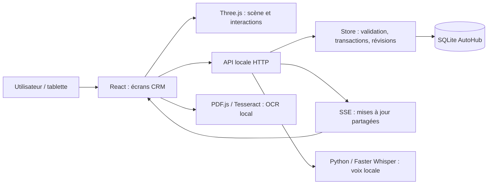

# AUTOHUB 3D — COMPTE RENDU COMPLET DU PROJET

État au 13 octobre 2026, Europe/Lisbon. Version applicative **0.3.0**. Rapport de passation fondé sur les fichiers réellement présents dans le dépôt et sur les validations consignées. Ce rapport décrit l’état actuel ; les anciens paragraphes chronologiques du README peuvent mentionner des modes désormais remplacés.

## 1. Ce que l’on construit

AutoHub est un CRM de garage automobile dont l’interface principale représente l’établissement en 3D. L’objectif est qu’un responsable ou un technicien repère un véhicule, un poste, une personne ou une zone puis accède immédiatement aux informations utiles. La maquette sert de porte d’entrée vers les dossiers, le travail atelier, les devis, les pièces, le planning et la restitution.

L’expérience visée est ludique et opérationnelle, avec une tablette utilisable à l’atelier. Le mode « Mains sales » augmente la taille des commandes et réduit les interactions secondaires. Le projet cherche progressivement une représentation plus réaliste de la concession et des véhicules.

**État réel : prototype local fonctionnel, pas encore un SaaS prêt à être vendu ou exposé sur Internet.** Des workflows et règles métier sont implémentés et testés. Les données de départ, références de pièces et exemples financiers restent fictifs. Aucun fournisseur automobile, SMS ou WhatsApp de production n’est connecté.

## 2. Périmètre et indépendance

Le projet réside dans `/Users/eythansouffir/Documents/ChatGPT/CRM 3D GARAGE`. Il possède son propre dépôt Git, ses dépendances, son serveur local, sa base SQLite, ses ressources et ses scripts. ORIA et Jarvis sont des projets distincts : aucun de leurs fichiers, environnements, secrets ou bases n’est requis dans cette livraison.

La branche de travail est `codex/autohub-prototype`. Aucun dépôt distant n’est configuré dans l’état documenté. Aucun service externe payant n’est activé. Les documents fournis servent de références et de cahier des charges, sans autoriser des actions sur d’autres comptes.

## 3. Parcours utilisateur de bout en bout

1. **Réception** : créer ou retrouver un dossier, saisir les renseignements du véhicule et du client, confirmer les champs extraits d’un document, consigner symptômes et échéance.
2. **Diagnostic** : consulter les codes et symptômes, chercher des cas internes comparables et enregistrer une piste avec son incertitude.
3. **Devis** : renseigner les opérations et prix manuels, calculer HT/TVA/TTC, soumettre le devis puis enregistrer explicitement l’accord client. Un brouillon de demande d’accord peut être préparé.
4. **Organisation** : attribuer technicien, ressource et créneau. Les règles détectent incompatibilités de compétences et conflits d’occupation.
5. **Intervention** : démarrer le temps de travail, mettre en pause, signaler un problème, demander une pièce, dicter une note, ajouter des photos et suivre la checklist.
6. **Responsable** : traiter les blocages et demandes, valider les réservations et références déclarées avant reprise.
7. **Fin et qualité** : terminer les contrôles ; le passage « Prêt à livrer » exige un contrôle qualité validé, également vérifié côté serveur.
8. **Livraison** : cliquer sur la zone Livraison, choisir un véhicule prêt, consulter la synthèse, l’échéance et les messages préparés ; marquer les étapes avec les contrôles applicables.
9. **Traçabilité** : les actions enregistrées alimentent le journal du dossier et la base partagée.

Statuts principaux : **Réception → Diagnostic → Devis à valider → En intervention → Contrôle qualité → Prêt à livrer → Livré**. Ce parcours décrit les étapes disponibles ; chaque changement dépend de ses règles et des données réellement enregistrées.

## 4. Interface et maquette 3D actuelle

### Disposition

La maquette s’inspire des photos et de la visite de la concession JOP Jaguar / Land Rover de Porto fournies par l’utilisateur. Jaguar se situe à gauche et Land Rover à droite de la façade vitrée. L’accueil et les espaces clients sont en façade ; l’atelier est à l’arrière, avec huit ponts rouges à droite et le parc de véhicules à gauche.

Il s’agit d’une interprétation spatiale, **pas d’un relevé architectural exact**. Les enseignes, la présence de la salle d’attente et trois espacements des postes (5, 6 ou 7 mètres) sont configurables et sauvegardés. La profondeur de l’atelier et les positions suivent ce réglage. La transformation arbitraire de toutes les pièces n’est pas encore un éditeur architectural.

Les neuf zones sont : accueil, atelier, salle d’attente, stocks, carrosserie, bureau, livraison, showroom et parc. L’accueil comprend un comptoir et un agent visible, et non uniquement une personne à l’entrée de l’atelier.

### Navigation retenue après les retours utilisateur

Les boutons Libre et Immersion ont été retirés. La vue d’ensemble donne un repère ; cliquer sur une zone ou un objet déclenche un cadrage progressif. La dernière évolution permet **de glisser pour déplacer la vue sur le sol**, sans rotation incontrôlée. La molette ou le pincement permet le zoom. La translation est bornée et le retour à la vue d’ensemble reste disponible.

La 3D occupe la hauteur disponible de l’espace principal. Le grand tableau de bord latéral permanent a été supprimé dans la vue garage. Les panneaux contextuels se superposent à la surface 3D ; ils ne constituent pas encore des écrans dessinés physiquement sur un objet dans le monde 3D. Leur contenu est lié à l’élément sélectionné.

Le brouillard a été éloigné afin de préserver le contraste au fond de l’atelier. Les murs et meubles gênant la visibilité de la cible peuvent être masqués. Les éléments invisibles ne doivent pas capturer le clic. Les cadrages sont calculés pour conserver la voiture ou la zone dans le champ, y compris sur écrans étroits. Les préférences de mouvement réduit sont prises en compte.

### Informations par zone

| Élément sélectionné | Informations proposées |
|---|---|
| Atelier | Véhicules, nombre d’interventions, accords attendus et techniciens |
| Livraison | Véhicules prêts, accès à leur synthèse et état des messages |
| Salle d’attente / accueil | Clients présents simulés dans la démonstration, puis dossier client |
| Client | Étape réelle enregistrée, dernier devis, montant, accord et restitution |
| Showroom | Inventaire commercial simulé distinct des véhicules de réparation |
| Stocks | Commandes datées du jour et commandes attendues |
| Bureau | Alertes et devis, accès aux vues correspondantes |
| Technicien | Identité et interventions affectées |
| Voiture | Synthèse courte puis accès au dossier complet |

Les commandes du jour utilisent le calendrier Europe/Lisbon. Une ancienne commande sans date reste « Date non renseignée » ; elle n’est pas artificiellement comptée comme une commande d’aujourd’hui.

### Techniciens et utilisation tactile

Huit profils sont disponibles : **Kader, Yanis, Sofiane, Mehdi, Thomas, Karim, Lucas et Rayan**. Les personnages originaux sont construits par géométrie procédurale : casquette, uniforme, gants, chaussures, détails du visage et prénom écrit sur le dos. Une étiquette permet aussi de les reconnaître. Ils restent illustratifs ; aucun scan humain réaliste n’a été importé.

Le mode « Mains sales » fournit des commandes d’au moins 64 pixels et des boutons de zone de 74 pixels, masque certaines actions secondaires et simplifie l’en-tête. L’affichage a été contrôlé avec une fenêtre de test 1024 × 768. Cela ne constitue pas un essai matériel avec des gants ou un écran industriel.

## 5. Dossiers, identification et AutoHub Scan

Chaque véhicule possède un identifiant interne, marque, modèle, plaque, client, coordonnées, kilométrage, année, couleur, symptômes, codes, statut, technicien, pont, échéance, qualité, notes et pièces. Des champs facultatifs ajoutent VIN, pays, modèle 3D, preuves d’extraction, présence physique, heure d’arrivée, estimation, moteur, département et réservations.

La réception peut s’appuyer sur des PDF texte, des PDF scannés et des images. PDF.js et Tesseract traitent les documents localement ; les résultats doivent être confirmés. Les exemples distribués sont explicitement fictifs. La recherche par plaque et VIN utilise les dossiers internes, avec normalisation et détection de doublons.

**Non connecté : identification externe officielle par plaque, données constructeur, SIV ou prestataire équivalent.** Saisir une plaque inconnue ne permet pas aujourd’hui de reconnaître automatiquement la génération exacte d’une voiture et d’en télécharger le modèle 3D. L’OCR n’est pas garanti sur tous les gabarits et toutes les conditions de prise de vue.

## 6. Atelier, temps de travail et responsable

L’écran atelier fonctionne indépendamment de la maquette. Il propose démarrer / pause, signaler un problème, demander une pièce, dicter un compte rendu, ajouter une photo et terminer. Il présente estimation, temps actif et pause, responsable, statut, emplacement des clés et checklist.

Le chronomètre est fondé sur les timestamps enregistrés par le serveur. Fermer ou recharger le navigateur ne remet pas le travail à zéro. Un technicien ne peut pas avoir deux sessions actives simultanées. La reprise et la fin sont soumises aux règles de blocage, devis, technicien et checklist.

Un problème crée une alerte interne et arrête le temps actif. Une demande de pièce est examinée par le responsable ; la quantité disponible et la réservation sont vérifiées. La validation d’une référence déclarée dans la démonstration ne prouve pas sa compatibilité OEM. Les trois contrôles de fin et la qualité empêchent une livraison prématurée.

Les photos sont compressées localement ; trois photos par dossier sont prévues, sans conservation de l’original et de ses métadonnées EXIF. Les QR codes contiennent le serveur et l’identifiant du dossier, sans plaque, VIN ou identité client ; ils ne remplacent pas un contrôle d’accès.

## 7. Voix et diagnostic assisté

### Voix locale

Le navigateur enregistre un audio de trente secondes maximum. Après installation dédiée, Faster Whisper transcrit sur ce Mac dans un environnement isolé. Les fichiers temporaires sont supprimés après traitement. L’assistant propose des actions structurées : pause, reprise, demande de pièce, problème, note, alerte, fin et temps restant. Le technicien confirme avant application.

L’incertitude de transcription est signalée ; les négations sont traitées pour éviter certaines erreurs de commande. La lecture du résumé dépend d’une voix française locale disponible. L’alternative texte reste accessible. Aucun fournisseur vocal payant et aucun entraînement sur les conversations ne sont branchés.

La logique d’actions est déterministe : **ce n’est pas un agent autonome à raisonnement général**. Les expressions non reconnues nécessitent une correction manuelle. Une confirmation entièrement vocale fiable et des essais réels en atelier bruyant restent à faire.

### Diagnostic

Quinze cas de démonstration sont liés à des dossiers : symptômes, DTC, tests, résultats, hypothèses, cause, réparation et résolution. Trois cas non résolus conservent les incertitudes et tests manquants. La recherche compare termes, codes et données déclarées ; elle affiche correspondances et différences.

L’import accepte notamment TXT, CSV, PDF texte et certaines images avec OCR local. Un PDF image de rapport peut nécessiter AutoHub Scan ou une extraction complémentaire. Il n’existe pas de compatibilité universelle OBD ni de base constructeur authentifiée. Les pistes enregistrées doivent être validées par un professionnel ; la recherche n’est ni un LLM de diagnostic ni une certitude mécanique.

## 8. Planning et équipe

Le planning offre des vues techniciens, ressources et départements. Les ressources comprennent les ponts et postes spécialisés. Les cartes montrent véhicule, symptômes, heure, durée, statut et priorité ; les modifications et glissements sont sauvegardés.

Les règles refusent les chevauchements et affectations incompatibles. Les alertes portent sur compétences, capacité, arrivée, devis, stock, durée et retards. Un premier créneau disponible est calculé depuis les réservations et horaires enregistrés. Les pauses, reprises et décisions se répercutent dans les vues.

Les horaires restent simples. Gestion complète des absences, jours de travail, tâches multiples, optimisation globale et géométrie détaillée des ressources sont à développer.

## 9. Pièces, stocks, devis et pilotage

### Pièces et stocks

Cinquante références de démonstration disposent de catégorie, unité, fournisseur fictif, prix achat/vente, emplacement, stock, réservé et seuil. Recherche, filtres, réservations liées aux dossiers, commandes préparées et réceptions simulées sont disponibles. Les mouvements sont tracés et une réservation ne peut pas créer un stock négatif.

Une réservation n’est pas une consommation physique. Sorties de pièces montées, retours et cycle complet de valorisation restent à compléter. Il n’existe pas de commande fournisseur réelle ni de tarif professionnel connecté.

### Devis et factures

Les devis manuels calculent HT, TVA et TTC avec contrôles d’arrondi, soumission, validation, verrouillage et impression de démonstration. L’accord est enregistré manuellement. Les devis validés sont protégés contre des modifications incohérentes.

Les exemples de factures et paiements sont fictifs. Il n’y a pas de facturation fiscale de production, paiement réel ou signature électronique. Les taux, prix et durées ne sont pas des données constructeur automatiquement vérifiées.

### Pilotage

Les indicateurs sont calculés depuis les enregistrements : véhicules présents, sessions, blocages, devis, livraisons, retards, postes disponibles, stocks critiques, rendez-vous et factures fictives. Les cohortes ouvrent les dossiers concernés et peuvent être mises en évidence dans la maquette.

## 10. Messages client : état exact

Le code `communication-domain.ts` prépare des brouillons WhatsApp de restitution ou d’accord sur devis. Le brouillon de restitution exige la qualité et un statut prêt / livré. Le brouillon de devis exige un devis à valider avec des lignes, et reprend son montant TTC. Les doublons identiques sont évités ; les brouillons et actions sont conservés.

**Aucun message n’est envoyé automatiquement.** Copier un brouillon ne prouve pas son envoi. Il n’y a pas de réception de réponse, de suivi livré / lu, de consentement automatique ou de connecteur SMS.

La synthèse d’une voiture affiche « SMS de récupération · aucun envoi confirmé » et distingue l’existence d’un brouillon WhatsApp. La structure actuelle des messages ne contient pas de preuve fournisseur de transmission. Pour afficher un jour « envoyé », il faudra un connecteur autorisé, un identifiant fournisseur, un canal, un destinataire, des horodatages et états vérifiables, ainsi que les réponses ou webhooks applicables.

## 11. Données de démonstration et modèles 3D

### Jeu de départ

| Élément | Quantité initiale |
|---|---:|
| Dossiers véhicules | 60 |
| Véhicules physiquement présents | 14 |
| Ponts | 8 |
| Ponts occupés au départ | 6 |
| Véhicules prêts à livrer | 4 |
| Techniciens | 8 |
| Références de pièces fictives | 50 |
| Devis validés | 5 |
| Cas de diagnostic | 15 |
| Sessions actives sur une base fraîche | 3 |
| Clients présents simulés | 3 |
| Véhicules commerciaux simulés du showroom | 3 |

Les véhicules du showroom sont distincts des quatorze véhicules de réparation. Les présences et le showroom fictifs ne sont pas ajoutés à un garage sans le marqueur de démonstration. Les compteurs d’une base utilisée peuvent évoluer ; cette archive ne contient pas la base active du Mac.

### Ressources importées

**11 fichiers GLB réellement importés**, dont dix véhicules génériques Kenney CC0 et le coupé original non marqué Spectral GT RS CC0. **0 modèle de marque exacte attestée importé.** BMW, Renault ou Land Rover peuvent être des noms de dossiers fictifs sans que la forme visible soit une maquette exacte de ce véhicule.

Le manifeste conserve sources, auteurs, droits déclarés/vérifiés, URL, état, taille, triangles et SHA-256. Les modèles génériques disposent de représentations simplifiées de secours à distance et de chargement progressif. Le coupé détaillé comporte 151 722 triangles et environ 4,7 Mo ; son affectation ne le transforme pas en modèle d’une marque connue.

Le catalogue initial regroupe 25 marques et dix objectifs courants : Audi A4/Q5, BMW Série 3/X5, Renault Clio/Mégane, Volkswagen Golf/Tiguan, Land Rover Range Rover/Defender. Leur téléchargement et la vérification année/génération/licence ne sont pas achevés. Les références externes non téléchargées ne sont pas comptées comme des actifs disponibles.

Les tentatives Sketchfab ont rencontré connexion obligatoire, délais et provenance insuffisante pour certaines ressources. Une licence non commerciale n’est pas retenue pour un CRM commercial. Aucun contournement du viewer ou récupération de cookies n’a été utilisé. Les pièces de freinage visibles restent des illustrations génériques et non des preuves de compatibilité.

## 12. Architecture technique



Frontend : React 19, TypeScript strict et CSS natif, Phosphor pour les icônes, DM Sans auto-hébergée. Three.js 0.180 gère WebGL et OrbitControls configuré pour la translation sans rotation. Vite compile et sert l’application. PDF.js/Tesseract servent aux documents ; QRCode aux liens atelier.

Serveur : plugin Vite utilisé en développement et aperçu, Node.js avec `node:sqlite`, API HTTP, SSE et script Python de transcription. La base `.data/autohub.sqlite` utilise WAL et un état JSON validé, plutôt qu’un schéma relationnel par entité. Trois tables techniques : `state`, `receipts`, `history`. Les vingt derniers états sont conservés dans l’historique technique.

Les transactions vérifient la révision avant écriture. Une requête possède un identifiant permettant son traitement idempotent ; une concurrence obsolète produit un conflit HTTP 409. Les actions atelier vérifient leurs règles au serveur ; des protections refusent des contournements de chronomètre ou qualité par un état client complet.

SSE transmet les changements aux autres écrans atteignant ce serveur. Le navigateur ne déclare pas une modification réussie si l’écriture échoue. Il existe un export/import JSON et une sauvegarde historique navigateur séparée de l’état V2 serveur. Ce système ne réalise pas une synchronisation hors ligne complète.

### API exposée

| Méthode | Route | Usage |
|---|---|---|
| GET | `/api/state` | État, révision et horloge serveur |
| GET | `/api/events` | Flux SSE d’état, heartbeat et changements |
| GET | `/api/speech/capabilities` | Disponibilité de la transcription locale |
| POST | `/api/change` | Actions validées et changements d’état |
| POST | `/api/voice/propose` | Proposition structurée sans application immédiate |
| POST | `/api/speech/transcribe` | Audio transcrit localement |

Le serveur vérifie certaines origines HTTP, impose une limite générale de 24 Mo et une limite audio de 8 Mo, pose des en-têtes de cache/type et supprime les temporaires audio dans un bloc de nettoyage. Ces protections ne remplacent pas une authentification, des rôles serveur et une isolation multi-client SaaS.

## 13. Code source et organisation

Tous les fichiers source sont livrés dans l’archive, dans leur arborescence d’origine. Un second document, `AUTOHUB_CODE_SOURCE_COMPLET.md`, regroupe le texte intégral du code, des tests, scripts et configurations pour lecture continue. Les GLB, images, données OCR et autres fichiers binaires restent dans l’archive et son manifeste, sans conversion en texte.

### Modules frontend

| Fichier | Responsabilité |
|---|---|
| `src/AssetLibrary.tsx` | Bibliothèque de modèles et références, licences et affectation au dossier. |
| `src/DeliveryDeadline.tsx` | Affichage des échéances et alertes de restitution. |
| `src/GuidedContext.tsx` | Tableaux de bord des zones, clients, showroom et synthèse courte du véhicule. |
| `src/Intelligence.tsx` | Recherche de cas de diagnostic, import de rapports et pistes à vérifier. |
| `src/ManagerRequests.tsx` | Traitement par le responsable des incidents et demandes de pièces. |
| `src/Pilotage.tsx` | Tableau de pilotage du garage et accès aux cohortes de dossiers. |
| `src/Planning.tsx` | Planning par technicien, ressource ou département et déplacements des réservations. |
| `src/Quotes.tsx` | Édition, calcul, soumission, accord manuel et impression des devis. |
| `src/ScanPanel.tsx` | Lecture locale de carte grise PDF/image et confirmation des champs. |
| `src/Stocks.tsx` | Recherche de pièces, quantités, réservations, commandes et réceptions simulées. |
| `src/Team.tsx` | Présentation de l’équipe et interventions affectées. |
| `src/VoiceAssistant.tsx` | Enregistrement local, proposition, lecture et confirmation des commandes. |
| `src/Workshop.tsx` | Interface de travail du technicien et grandes actions atelier. |
| `src/api.ts` | Client HTTP et synchronisation avec le serveur local. |
| `src/assets.ts` | Catalogue et chargement des modèles 3D ; cache et représentations de secours. |
| `src/camera-navigation.ts` | Calcul des cadrages voiture/zone, visibilité et interpolation angulaire. |
| `src/camera-occlusion.ts` | Détection des murs et meubles qui masquent un élément ciblé. |
| `src/communication-domain.ts` | Préparation idempotente de brouillons WhatsApp ; aucun envoi externe. |
| `src/dashboard-domain.ts` | Indicateurs calculés à partir des données métier. |
| `src/dealership-layout.ts` | Configuration du lieu inspiré de Porto : enseignes, attente et espacement des ponts. |
| `src/demo.ts` | Jeu de données fictif V2 cohérent. |
| `src/diagnostic-domain.ts` | Recherche déterministe de cas, termes et codes ; preuves et incertitudes. |
| `src/domain.ts` | Types centraux, validation/import, statuts, positions et opérations transversales. |
| `src/guided-domain.ts` | Présences simulées, inventaire showroom distinct, véhicules par zone et commandes du jour. |
| `src/identification.ts` | Extraction de champs, normalisation plaque/VIN, preuves et doublons. |
| `src/main.tsx` | Application principale : navigation, état partagé, réglages, dossiers, interface 3D et actions. |
| `src/navigation.ts` | Géométrie des obstacles, destinations praticables et chemins A* hérités du prototype. |
| `src/persistence.ts` | Gestion des sauvegardes navigateur historiques. |
| `src/planning-domain.ts` | Créneaux, compétences, collisions et alertes du planning. |
| `src/quote-domain.ts` | Règles des devis, calculs et protection des devis validés. |
| `src/scene.ts` | Scène Three.js : bâtiment, véhicules, techniciens, sélection, cadrages, glissement et animation. |
| `src/style.css` | Styles du CRM, interface tactile, adaptation des écrans et panneaux intégrés. |
| `src/team-data.ts` | Huit profils, spécialités, départements et ressources. |
| `src/voice-domain.ts` | Analyse déterministe des commandes françaises et contrôle des actions proposées. |
| `src/workshop-domain.ts` | Sessions, pauses, incidents, demandes de pièces, validation et fin des travaux. |

### Serveur, scripts et tests

- `server/store.ts` : transactions SQLite, état, révisions, idempotence et règles métier serveur.
- `server/plugin.ts` : API, SSE, limites de requête et orchestration de transcription.
- `server/transcribe.py` : exécution de la transcription locale.
- `scripts/prepare-ocr.mjs` : préparation du worker et des ressources OCR.
- `scripts/prepare-credits.mjs` : copie des licences des dépendances.
- `scripts/import-assets.mjs` : import des ressources génériques et manifeste.
- `scripts/import-detailed-model.mjs` : import du coupé détaillé et preuve de ressource.
- `scripts/setup-speech.mjs` : installation dédiée de Faster Whisper et du modèle.
- `scripts/verify-api.mjs` : contrôle HTTP/SSE/concurrence/voix sur base isolée.
- `scripts/verify-scan.mjs` : vérification des documents fictifs texte, scan et photo.
- `tests/domain.test.ts` : qualité, affectations, stock, sauvegarde, navigation et validation.
- `tests/extensions.test.ts` : chronométrage, devis, import et extensions du workflow.
- `tests/v2.test.ts` : cohérence V2, planning, voix et workflow SQLite.
- `tests/communication.test.ts` : brouillons et absence d’envoi/accord implicite.
- `tests/camera.test.ts` : cadrages, projection, occlusion et visibilité.
- `tests/guided.test.ts` : zones, séparation des simulations et dates des commandes.

`package.json` et `package-lock.json` décrivent les dépendances et versions résolues. `tsconfig.json` active les contrôles TypeScript pour frontend et serveur. `vite.config.ts` relie le serveur local et la compilation. `index.html` est le point d’entrée. `AGENTS.md` fixe le périmètre AutoHub.

## 14. Installation et reprise du projet

### Prérequis

Node.js 24 recommandé, npm et un navigateur WebGL. Pour la transcription facultative : Python 3.13, FFmpeg, installation dédiée et espace pour le modèle. L’installation de dépendances et de voix nécessite un accès aux registres publics ; le traitement de documents et d’audio se fait ensuite localement avec les ressources nécessaires installées.

### Depuis l’archive

Décompresser `AUTOHUB_PROJET_COMPLET_2026-10-13.zip`, ouvrir le dossier `AUTOHUB`, puis exécuter :

```sh
npm ci
npm run dev
```

Ouvrir `http://127.0.0.1:5173/`. Vite indique un autre port si celui-ci est occupé. Une base absente est initialisée avec les données fictives ; l’archive ne restaure pas les données privées ou modifications de la base active.

```sh
# Vérifications et production locale
npm test
npm run build
npm run preview

# Fonction vocale facultative
npm run speech:setup

# Contrôles complémentaires sur leurs données de test
npm run verify:api
npm run verify:scan
```

Le lancement de développement est limité à `127.0.0.1`. Sur un autre appareil, `localhost` désigne cet autre appareil et non le Mac. Un accès tablette distant demande une mise en service joignable et sécurisée ; ouvrir publiquement le serveur actuel ne suffit pas.

Les ressources OCR préparées automatiquement et les dépendances installées ne sont pas incluses comme copies de `node_modules`. Les fichiers nécessaires distribués dans `public` et les scripts de préparation accompagnent le code. Le modèle vocal et l’environnement Python sont réinstallables, pas archivés.

## 15. Vérifications et preuves

La dernière version applicative a passé **42 tests**, le type-check frontend/serveur et la compilation de production. Le build signale encore des chunks supérieurs à 500 Ko ; ce n’est pas une erreur de compilation, mais une piste d’optimisation du chargement.

Les tests couvrent notamment : cohérence des 60 dossiers et 14 présences, positions distinctes, protection qualité, stock, réservations, devis, données importées, temps actif et pauses, règles de reprise, planning, voix, négations, réouverture SQLite, concurrence, idempotence, provenance des GLB génériques et cadrage des zones/voitures.

Le rapport API conservé au 13 octobre 2026 documente cinq contrôles isolés : état HTTP cohérent, SSE vers un second client, doublon et conflit, proposition vocale HTTP, transcription d’un audio français synthétique. Ce rapport est une preuve antérieure ; il n’a pas été réexécuté pour la seule création de cette archive.

Interactions vues dans Chrome : attente → Manon → devis correspondant ; atelier → Yanis avec prénom sur le dos ; showroom et stocks ; mode tactile 1024 × 768 ; glissement sans sélection involontaire ; livraison → Volvo → synthèse ; retour à la vue générale. Les captures pertinentes accompagnent le projet. Les tests de navigateur ne constituent pas une preuve d’absence de tout bug sur tous les appareils.

Pas de validation physique complète du micro, des gants, d’une journée réelle d’atelier, de performance à grande échelle ou de déploiement de production. Cette livraison documentaire vérifie aussi le contenu de l’archive, les empreintes et la présence de chaque fichier source.

## 16. Limites et travaux restant à accomplir

| Domaine | Limite actuelle | Travail requis |
|---|---|---|
| Mise en production | Prototype local sans authentification | Comptes, rôles serveur, HTTPS, sessions, sauvegardes et supervision |
| SaaS | Pas d’isolation multi-tenant fiable | Modèle garage/utilisateur, accès et isolation des données |
| Véhicules | Illustrations génériques | Modèles exacts autorisés, génération/année, optimisation tablette |
| Identification | Recherche interne uniquement | Prestataire plaque/VIN autorisé et mapping contrôlé |
| Personnages | Géométrie procédurale | Modèles humains licenciés et animations utiles |
| Maquette | Lieu inspiré de Porto | Éditeur de zones, dimensions et placements plus flexible |
| SMS/WhatsApp | Brouillons locaux | Connecteur, consentements, envoi confirmé et suivi fournisseur |
| Pièces | Références/prix fictifs | Catalogues professionnels, compatibilité et fournisseurs |
| Stock | Réservations et réception simulée | Consommation, retours, inventaire, valorisation |
| Facturation | Documents et paiements démo | Cadre fiscal applicable, documents et flux de paiement réels |
| Planning | Horaires simples | Absences, tâches multiples et optimisation globale |
| Diagnostic | Recherche déterministe interne | Sources autorisées, enrichissement et validation des connaissances |
| Voix | Commandes limitées et confirmation tactile | Tests en bruit réel et meilleure gestion des incertitudes |
| Synchronisation | Connexion au même serveur | Reconnexion robuste, politique hors ligne et conflits plus fins |
| Base | Un état JSON dans SQLite | Schéma relationnel et migrations pour la montée en charge |
| Performance | Certains bundles et modèle détaillé lourds | Chargement différé, budgets géométriques et tests sur tablettes |

Ordre proposé pour la suite : stabiliser le parcours 3D sur tablette réelle ; acquérir des véhicules/humains avec licences confirmées ; sécuriser comptes et accès ; connecter l’identification et la messagerie avec preuves ; finaliser stock et facturation ; industrialiser l’hébergement et la structure des données. Cette liste est une proposition de priorisation, pas un engagement sur une date ou un budget.

## 17. Ressources, licences et propriété

Les crédits existants sont fournis dans `THIRD_PARTY.md`, `public/licenses` et les preuves du dossier modèles. Kenney Car Kit et Spectral GT RS sont déclarés CC0 dans le manifeste avec preuves conservées. Les dépendances conservent leurs licences ; les données OCR françaises sont distribuées avec leur notice.

Les liens Sketchfab du catalogue sont des références à vérifier, pas des fichiers redistribués. Les marques et enseignes utilisées dans la démonstration ne constituent pas un partenariat ou une autorisation commerciale de leur titulaire. Aucune licence commerciale globale nouvelle n’est attribuée au code AutoHub par ce rapport.

Aucune nouvelle recherche juridique ou vérification externe de licence n’a été effectuée pour ce rapport : il restitue les preuves locales existantes. Avant publication, revoir les droits des ressources effectivement utilisées et les règles applicables au produit final.

## 18. Contenu exact de la remise

1. **Rapport** : ce document, couvrant le produit, l’architecture, la reprise et les limites.
2. **Code intégral lisible** : `AUTOHUB_CODE_SOURCE_COMPLET.md`, copies textuelles complètes des modules, serveur, tests, scripts et configurations ; aucun extrait à la place d’un fichier source.
3. **Archive exécutable après installation** : `AUTOHUB_PROJET_COMPLET_2026-10-13.zip`, source, verrou de dépendances, GLB importés, licences, données fictives, documents et preuves sélectionnées.
4. **Manifeste** : `MANIFESTE_LIVRAISON.json`, liste de fichiers, tailles, SHA-256, révision et exclusions ; `SHA256SUMS.txt` pour les livrables.

Exclus volontairement : base SQLite active et historique privé, `.env`, secrets, historique Git, dépendances installées, build compilé, environnement Python, modèle vocal installé, temporaires et originaux vidéos de référence. La capture de connexion Sketchfab et les images de vidéos tierces ne sont pas reprises dans l’archive. Ces exclusions n’enlèvent aucun fichier de code source de l’application.

La remise reste sur le Mac ; elle n’est ni publiée ni envoyée à un tiers. Pour remettre le projet à un développeur, transmettre l’archive et ce rapport : aucun accès à ORIA ou à la base active n’est nécessaire.

## 19. Repères d’évolution

Révision photographiée dans cette livraison : `cb383e562bb8522d0bb0495fc6a3eab9a26a13b4`.

- cb383e5 Expand spatial workspace with sliding navigation and embedded summaries
- 7cbc11b Make AutoHub 3D a guided touch workspace with client contexts
- f0f83f0 Fix 3D vehicle framing, occlusion and walk destinations
- baa8897 Prioritize common real vehicle models and record download blockers
- edad936 Record browser verification of dealership settings and vehicle focus
- a338051 Add Porto-inspired dealership, vehicle camera focus and WhatsApp drafts
- 47eed8b Connect AutoHub V2 live garage, local voice, SQLite and resource planning
- 599ebf4 Build standalone AutoHub 3D garage and local workshop workflows

Le code livré correspond à cette révision applicative. Les livrables documentaires sont ajoutés séparément ; ils ne modifient pas les workflows ou les données du garage.
